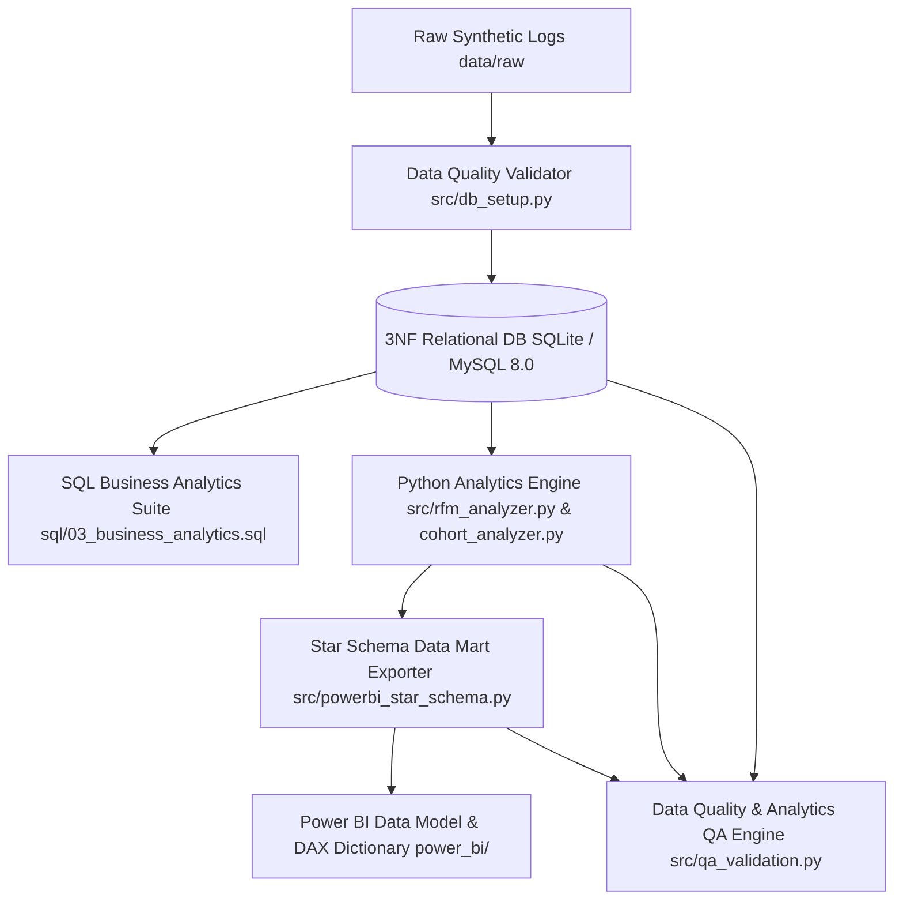

# Retail Revenue & Customer Intelligence Platform

> **DATA TRANSPARENCY NOTICE**: All datasets, database schema records, analytical figures, RFM personas, cohort retention matrices, and Power BI visual specifications in this repository are derived from **100% synthetic** retail transaction data generated for portfolio analytics demonstration.

---

## 📌 Executive Overview

The **Retail Revenue & Customer Intelligence Platform** is an end-to-end, multi-layered Business Intelligence and Customer Analytics solution built for modern multi-category retail e-commerce enterprises.

The platform processes transactional raw logs into a clean **3NF Relational Database** (MySQL 8.0 compatible), executes an 18-question **SQL Business Analytics Suite**, runs a **Python Data Science Engine** for RFM Customer Segmentation and Monthly Cohort Retention/LTV analytics, exports a high-performance **Power BI Star Schema**, and enforces a **Data Quality & Analytics QA Framework** with 69 automated reconciliation assertions.

---

## 🛠️ Technology Stack & Architecture

* **Database & SQL Engine**: MySQL 8.0 / SQLite 3, Relational 3NF Schema, Indexing, CTEs, Window Functions (`ROW_NUMBER`, `NTILE`, `LAG`, `LEAD`), Conditional Aggregations.
* **Data Engineering & Science**: Python 3.11, Pandas, NumPy, Data Quality Validator.
* **Customer Intelligence**: RFM Quantile Scoring (5x5x5 Matrix, 7 Personas), Monthly Cohort Retention Analysis, Realized Cumulative LTV Trajectory Modeling.
* **Business Intelligence (Power BI)**: Star Schema Data Mart (`FactOrders`, `FactOrderItems`, `FactShipping`, `DimCustomer`, `DimProduct`, `DimCategory`, `DimDate`), 20 DAX Measures, 4-Page Dashboard Layout Specifications.
* **QA & Analytics Testing**: Python Automated QA Engine (`src/qa_validation.py`), Data Quality Rules Catalog, Formal Defect Remediation Log.



---

## 📊 Key Authoritative Business Metrics

All figures below are mathematically reconciled across SQL queries, Python dataframes, and Power BI star schema tables with **zero variance**:

| Key Performance Indicator | Authoritative Value | Metric Definition / Context |
|:---|:---:|:---|
| **Total Net Revenue** | **$3,990,811.00** | Net revenue from 5,842 completed & shipped orders |
| **Total Valid Orders** | **5,842 orders** | Distinct completed and shipped transactions |
| **Active Customer Base** | **1,107 customers** | Registered customers with valid completed purchases |
| **Average Order Value (AOV)** | **$683.12** | Total Net Revenue / Total Orders |
| **Total Gross Profit** | **$1,240,548.65** | Cumulative line-item product gross margin |
| **Gross Profit Margin %** | **31.09%** | Gross Profit / Total Net Revenue |
| **Carrier SLA Compliance Rate** | **74.47%** | Delivered On-Time / Delivered Total (3,959 / 5,316) |
| **Product Catalog SKUs** | **40 SKUs** | Active SKUs across 8 Product Categories |
| **Champions RFM Revenue** | **$2,193,910.01** | Revenue generated by top-tier *Champions* segment (54.97%) |
| **Cohort Month 1 Retention** | **40.98%** | Average customer retention 1 month post-acquisition |
| **Cohort Month 6 Retention** | **19.54%** | Simple arithmetic average retention 6 months post-acquisition |
| **12-Month Realized LTV** | **$3,377.90** | Average realized cumulative revenue per customer at 12 months |

---

## 📂 Repository Structure

```
.
├── data/
│   ├── raw/                       # Raw synthetic transaction CSVs (intentional flaws)
│   ├── processed/                 # Cleaned relational datasets & analytical CSV summaries
│   └── retail_intelligence.db     # SQLite 3NF production database
├── sql/
│   ├── 01_schema_setup.sql        # DDL table creation scripts with foreign keys & indexes
│   ├── 02_data_quality_checks.sql # Automated data quality audit queries
│   └── 03_business_analytics.sql  # 18-question MySQL 8.0 Business Analytics Suite
├── src/
│   ├── data_generator.py          # Multi-table synthetic data generator
│   ├── data_quality_validator.py  # Data hygiene audit & remediation engine
│   ├── db_setup.py                # Database initializer & ETL pipeline
│   ├── sql_analytics_engine.py    # SQL query execution wrapper
│   ├── rfm_analyzer.py            # RFM customer segmentation engine (7 personas)
│   ├── cohort_analyzer.py         # Monthly cohort retention & LTV engine
│   ├── export_summary_marts.py    # Aggregated analytical summary exporter
│   ├── generate_notebook.py       # Portfolio Jupyter notebook generator
│   ├── powerbi_star_schema.py     # Power BI star schema transformation engine
│   ├── phase4_validation.py       # Cross-platform validation suite (47 assertions)
│   └── qa_validation.py           # Comprehensive QA framework engine (22 assertions)
├── notebooks/
│   └── retail_revenue_customer_intelligence.ipynb # Executed portfolio notebook
├── power_bi/
│   ├── data_sources/              # 9 CSV files ready for Power BI Desktop import
│   ├── data_model.md              # Star Schema ERD, table specs, and import protocol
│   ├── dax_measure_dictionary.md  # 20 production-grade DAX measures
│   ├── dashboard_specification.md # Layout grid, chart specifications & visual guidelines
│   └── metric_definitions.md      # Authoritative cross-platform metric dictionary
├── qa/
│   ├── test_cases.md              # Formal 22 QA test cases table
│   ├── data_quality_rules.md      # Business & technical data quality rules catalog
│   ├── defect_log.md              # Synthetic data remediation log (DEF-01 to DEF-05)
│   └── validation_report.md       # Final QA execution audit report (22 Passed / 0 Failed)
└── requirements.txt               # Python package dependencies
```

---

## ⚡ Quick Start & Execution

### 1. Environment Setup
```bash
git clone https://github.com/Taniiie/Retail-Revenue-Customer-Intelligence-Platform.git
cd Retail-Revenue-Customer-Intelligence-Platform
pip install -r requirements.txt
```

### 2. Database Initialization & ETL Pipeline
```bash
python src/db_setup.py
```

### 3. Run Business Analytics & Customer Intelligence Engines
```bash
python src/sql_analytics_engine.py
python src/rfm_analyzer.py
python src/cohort_analyzer.py
python src/powerbi_star_schema.py
```

### 4. Execute Complete QA & Cross-Platform Reconciliation Suite
```bash
python src/qa_validation.py
python src/phase4_validation.py
```

---

## 📜 License & Citation

Distributed under the MIT License. Created for professional Data Analyst portfolio demonstration.
